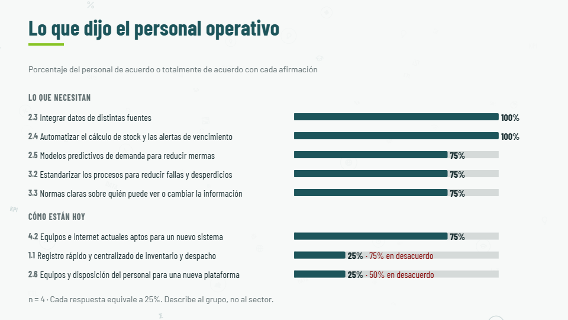
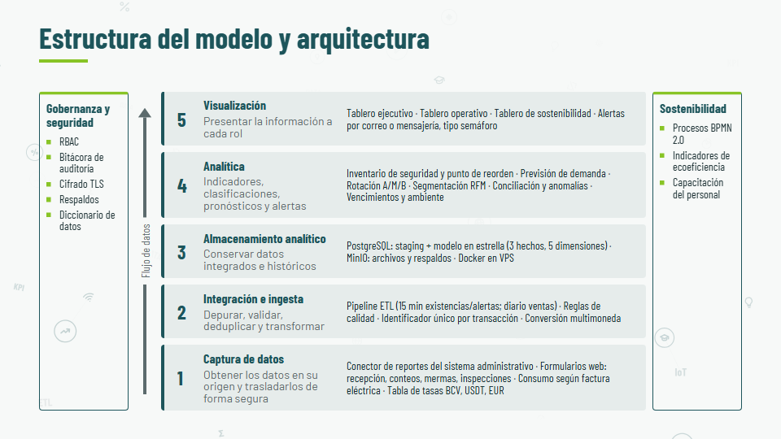
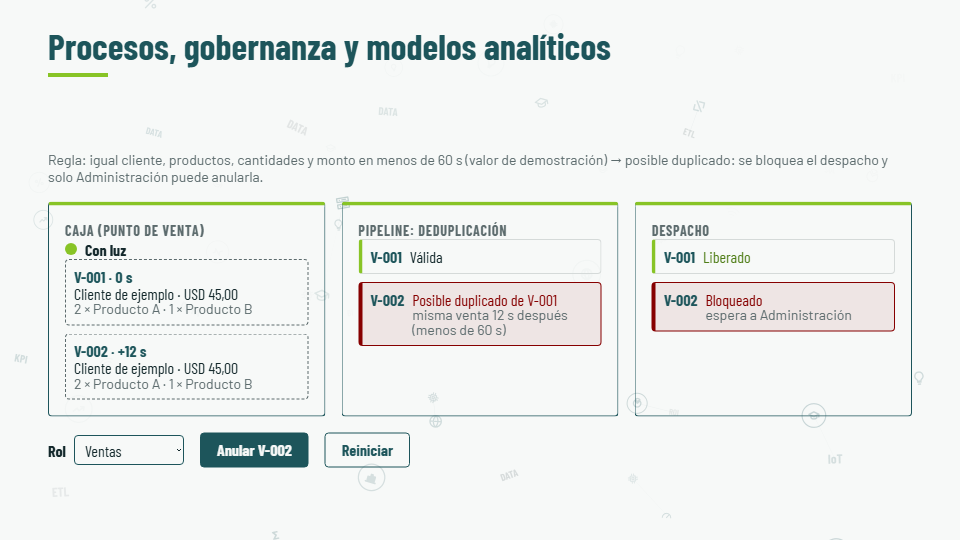
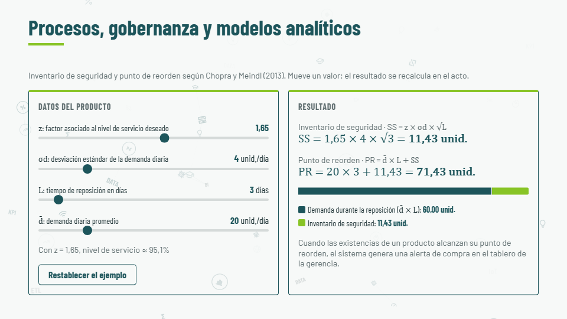
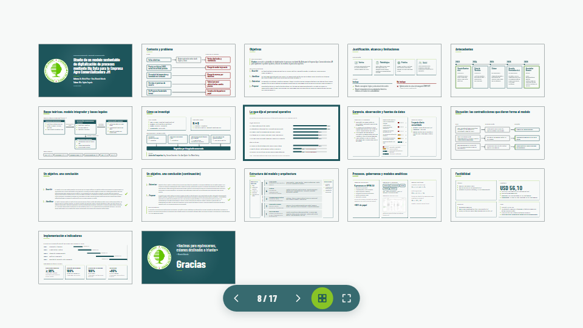

# Defensa TEG – Modelo AgroData JM

Presentación web para la defensa del Trabajo Especial de Grado «Diseño de un modelo sustentable de
digitalización de procesos mediante Big Data para la Empresa Agro Comercializadora JM» —
Universidad Valle del Momboy, Ingeniería en Computación, 2026.

**Autores:** Br. Rafael Pérez · Técn. Ricardo Briceño — **Tutora:** MSc. Yajaira Segovia.

**Presentación en línea:** <https://ricardo-dev-brj.github.io/Defensa-TEG/> (se publica sola en cada
push a `main`; ver [Publicar en GitHub Pages](#publicar-en-github-pages)).

## Capturas

| Portada: el isologo se arma con partículas | Resultados del cuestionario (barras SVG) |
| --- | --- |
|  |  |
| **Arquitectura por capas (flujo de datos y capas 3D)** | **Simulador de corte de luz y ventas duplicadas** |
|  |  |
| **Calculadora de inventario de seguridad y punto de reorden** | **Mapa de láminas y panel de controles** |
|  |  |

## Características

- **17 láminas** para 19 minutos (más **4 de reserva**, solo por número), en un escenario fijo de
  1920 × 1080 que se escala a cualquier pantalla, con margen seguro del 5 % para el televisor.
- **Cifras desde `data/*.json`**, transcritas y verificadas contra el TEG: ningún número del TEG está
  escrito a mano en las láminas, y las pruebas comprueban que cada dato exista.
- **Componentes interactivos** con su lógica separada y probada: barras de resultados, medidores de
  nivel, flujo de datos por capas (con capas 3D), simulador de duplicados, calculadora SS/PR,
  contador de costos, cronograma (Gantt) y el isologo en partículas.
- **Sin internet al presentar:** HTML, CSS y JavaScript nativos, sin librerías en tiempo de ejecución;
  las fuentes están dentro del repositorio.
- **Pensada para la defensa:** pasos con el control remoto, tecla S para terminar animaciones,
  pantalla negra, mapa de láminas, panel de controles que se oculta solo y exportación a PDF.
- **Accesible:** texto de 28 px o más, contraste AA comprobado y respeto de `prefers-reduced-motion`.

## Requisitos

- Node.js 22 (o 20.19 o posterior) y npm.
- Para presentar: Chrome o Edge actualizados.

## Instrucciones

### Instalar y presentar

```sh
npm ci            # instala las versiones exactas de package-lock.json
npm run dev       # abre la presentación en http://localhost:5173
```

En el navegador, **F** pone la pantalla completa y **→** avanza. Para ir a una lámina de reserva:
**G**, el número y **Enter** (por ejemplo, G 2 1 Enter).

### Comandos

| Comando | Qué hace |
| --- | --- |
| `npm run dev` | Servidor de desarrollo con recarga al guardar |
| `npm test` | Pruebas con Vitest (lógica, datos, reglas visuales) |
| `npm run lint` | ESLint y Prettier (formato y estilo) |
| `npm run format` | Corrige el formato con Prettier |
| `npm run build` | Genera `dist/`, la versión que se publica |
| `npm run preview` | Sirve `dist/` en local para probar la versión publicada |
| `npm run metricas` | Mide el repositorio y actualiza las cifras de la lámina 21 (`data/construccion.json`) |
| `npm run qr -- https://…` | Genera el QR del cierre (`public/img/qr.svg`) |

`dist/` se abre con `npm run preview` o desde el sitio publicado. Abrirlo con doble clic
(`file://`) todavía no funciona: el navegador bloquea los módulos (pendiente, ADR-006 §8).

### Exportar a PDF

Con la presentación abierta: **Ctrl + P → Guardar como PDF**. Sale una lámina principal por página
(16:9), con todos sus pasos y componentes en el estado final, sin las láminas de reserva
(`src/styles/print.css`).

### Publicar en GitHub Pages

El workflow [`.github/workflows/deploy.yml`](.github/workflows/deploy.yml) se ejecuta en cada push a
`main` (o a mano, desde la pestaña Actions): instala, pasa el lint y las pruebas, construye `dist/` y
lo publica. Si el lint o una prueba fallan, no se publica.

Configuración única en GitHub: **Settings → Pages → Build and deployment → Source: GitHub
Actions**. Todo lo que esté en `main` queda público en el sitio (con un repositorio privado, Pages
requiere un plan de pago de GitHub).

### Antes de la defensa

1. `npm run metricas` para que la lámina 21 muestre las cifras del día, y `npm test`.
2. Probar en el televisor de la sala: pantalla completa, control remoto y la tecla **E** (apaga los
   efectos si el equipo va lento o distraen).
3. Tener el PDF como respaldo.

## Atajos de teclado

| Tecla | Acción |
| --- | --- |
| **→**, **Espacio**, **AvPág** | Siguiente paso o lámina |
| **←**, **RePág** | Paso o lámina anterior (llega en su estado final) |
| **G** + número + **Enter** | Ir a una lámina (la única forma de llegar a la reserva 18–21) |
| **O** | Mapa de láminas (vista general); **Esc** o **Enter** lo cierran |
| **F** | Pantalla completa |
| **B** o **.** | Pantalla negra (muchos controles remotos envían «.») |
| **S** | Terminar las animaciones de la lámina actual |
| **E** | Encender o apagar los efectos (partículas y 3D) |
| **P** / **T** | Presentador y cronómetro (Fase 5, aún no disponibles) |

Un clic avanza, salvo sobre botones, deslizadores, el isologo de la portada y las demostraciones.

## Panel de controles

Al mover el ratón aparece abajo un panel con **anterior · contador · siguiente · mapa · pantalla
completa**. Se oculta solo, junto con el puntero, a los 2,5 s de dejar el ratón quieto; las teclas
no lo muestran, así que con el control remoto nunca aparece.

## Portada y fondo

En la portada, el isologo se arma con partículas de sus propios colores: el cursor las aparta y un
clic sobre él lo dispersa. Detrás de todas las láminas flotan íconos de datos que se apagan detrás
de los textos (tecla **E** para quitarlos). El prototipo original está en
[`docs/referencias/particulas-uvm.html`](docs/referencias/particulas-uvm.html).

## Estructura del proyecto

| Ruta | Qué es |
| --- | --- |
| `src/core/` | Motor: deck (láminas y pasos), router (`#/n`), teclado, escalado, datos, controles, efectos |
| `src/components/` | Componentes interactivos de las láminas |
| `src/slides/` | Una lámina por archivo HTML (sus cifras llegan desde `data/` con `data-dato`) |
| `src/styles/` | Tokens (única fuente de colores y tamaños), estructura, plantillas, componentes e impresión |
| `data/` | Cifras transcritas del TEG y `construccion.json` (medido del repositorio) |
| `tests/` | Pruebas de Vitest |
| `scripts/` | Generador del QR y medición del repositorio |
| `public/` | Isologo UVM, figuras del TEG, capturas del sistema y fuentes |
| `docs/` | Guion, plan, requisitos, decisiones (ADR), identidad visual, capturas y referencias |
| `.claude/commands/` | Comandos `/nueva-lamina`, `/revisar-lamina`, `/verificar-datos`, `/ensayo` |
| `.github/workflows/` | Publicación en GitHub Pages |

## Documentación

- [`docs/guion.md`](docs/guion.md): guion de la defensa (fuente de verdad del contenido).
- [`docs/decisiones.md`](docs/decisiones.md): registro de decisiones de arquitectura (ADR).
- [`docs/plan-desarrollo.md`](docs/plan-desarrollo.md) y [`docs/requisitos.md`](docs/requisitos.md).
- [`docs/identidad-visual.md`](docs/identidad-visual.md): paleta, tipografía e isologo.
- [`CLAUDE.md`](CLAUDE.md) y [`PROMPTS.md`](PROMPTS.md): reglas y fases del trabajo con Claude Code.

## Licencia

- **Código:** licencia MIT © 2026 Rafael Pérez y Ricardo Briceño (ver [`LICENSE`](LICENSE)).
- **Contenido** (datos y textos del TEG, documentos, textos de las láminas, figuras, capturas del
  sistema y de la presentación): todos los derechos reservados.
- **Isologo de la Universidad Valle del Momboy:** marca de la universidad; no se licencia.
- **Fuentes Barlow y Barlow Condensed:** SIL Open Font License 1.1 (texto en `public/fonts/`).
